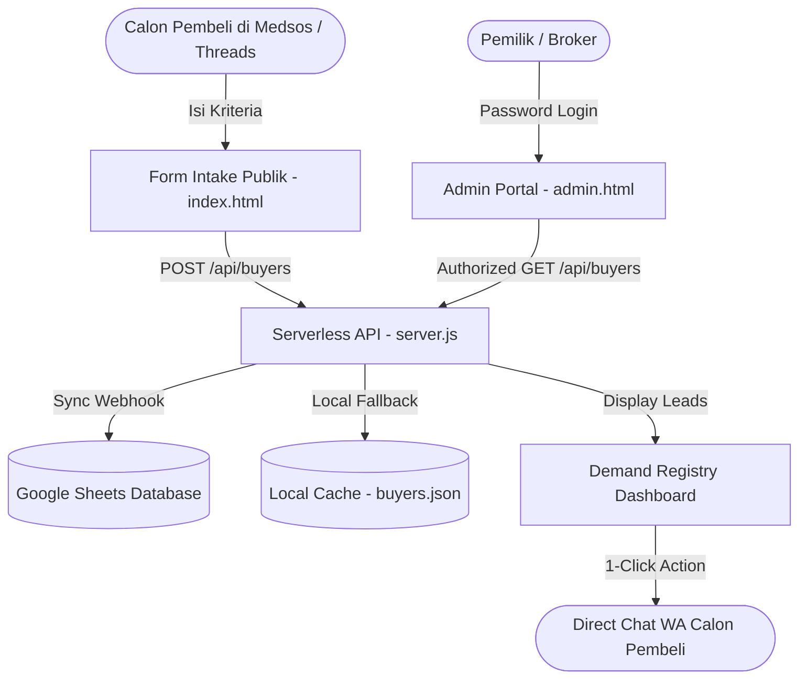

<div align="center">

# PropertySF &bull; Direct-Owner Property Sourcing Engine

[](https://opensource.org/licenses/MIT)
[](https://nodejs.org/)
[](https://vercel.com/)
[-success.svg)](https://sheets.google.com/)

**Platform kurasi independen yang membalik model transaksi properti konvensional: Menampung permintaan pembeli terverifikasi (*qualified buyer demand*) dan mencocokkannya dengan listing pemilik langsung (*direct-owner*) dari media sosial.**

[Fitur Utama](#-fitur-utama) &bull; [Arsitektur Sistem](#-arsitektur-sistem) &bull; [Instalasi Lokal](#-instalasi-lokal) &bull; [Deploy ke Vercel](#-deploy-ke-vercel) &bull; [Google Sheets Setup](#-integrasi-google-sheets)

</div>

---

## 📌 Mengapa PropertySF?

Di platform media sosial seperti **Meta Threads**, ratusan pemilik properti (*direct owners*) setiap hari menawarkan aset rumah, ruko, tanah, atau gedung dengan iming-iming komisi perantara (1.5% – 3% / puluhan juta rupiah) karena frustrasi dengan lamanya penjualan konvensional.

Namun, memasarkan rumah tanpa tahu siapa pembelinya sering berujung sia-sia (*low conversion*).

**PropertySF membalik paradigma tersebut (Reverse Matching):**
1. **Demand-First:** Menampung kebutuhan pembeli serius (budget, preferensi KPR/cash, kota target) melalui formulir terkurasi.
2. **Sourcing Match:** Mencocokkan data pembeli dengan listing *direct-owner* berharga wajar dari Threads.
3. **Closing Safe:** Melakukan penutupan transaksi (co-brokering / direct fee) tanpa risiko *bypass*.

---

## ✨ Fitur Utama

- 🏛️ **Editorial Minimalist UI:** Desain antarmuka arsitektural kontemporer (terinspirasi dari *Linear* & *Airbnb Luxe*) tanpa ornamen generik / AI-slop.
- ⚡ **Multi-Step Guided Wizard:** Formulir 4 langkah ramah perangkat bergerak (*mobile-first*) dengan kalkulasi parameter terstruktur.
- 🎛️ **Smart Suggestion & Free Input:** Rekomendasi tipe properti 1-klik sekaligus mendukung pengetikan kustom tanpa batasan kaku.
- 🔄 **Flexible Toggles:** Filter jumlah kamar dan akses jalan dapat dinonaktifkan secara fleksibel untuk pembeli tanah, ruko, atau gudang.
- 🔒 **Admin Password Gatekeeper:** Portal registri internal dan REST API dilindungi oleh kata sandi rahasia (`ADMIN_PASSWORD`).
- 📊 **Real-Time Google Sheets Sync:** Data terkirim secara instan ke spreadsheet pemilik tanpa biaya langganan database server pihak ketiga.
- ☁️ **Vercel Serverless Architecture:** Dikonfigurasi untuk *zero-config deployment* di infrastruktur Edge Vercel.

---

## 🏛️ Arsitektur Sistem



---

## 🚀 Instalasi & Menjalankan di Lokal

### Prasyarat
- [Node.js](https://nodejs.org/) versi 18 atau lebih baru.
- Akun Google (untuk Google Sheets).

### Langkah Instalasi
```bash
# 1. Clone repository
git clone https://github.com/RezaBagusS/Property-Sf.git
cd Property-Sf

# 2. Install dependencies
npm install

# 3. Salin environment template
cp .env.example .env

# 4. Jalankan server lokal
npm start
```

Aplikasi aktif di:
- **Formulir Publik:** [http://localhost:3500/](http://localhost:3500/)
- **Admin Registry:** [http://localhost:3500/admin.html](http://localhost:3500/admin.html) *(Password bawaan: `admin123456`)*

---

## ☁️ Deploy ke Vercel

Repository ini telah dilengkapi dengan [`vercel.json`](./vercel.json) dan entry point [`api/index.js`](./api/index.js).

### Langkah Deploy:
1. Hubungkan akun GitHub Anda ke [Vercel](https://vercel.com/).
2. Klik **Add New Project** $\rightarrow$ **Import** repository `RezaBagusS/Property-Sf`.
3. Di panel **Environment Variables**, tambahkan:
   | Key | Value Contoh | Deskripsi |
   | :--- | :--- | :--- |
   | `ADMIN_PASSWORD` | `rahasia2026` | Password untuk membuka portal admin |
   | `GOOGLE_SHEET_WEBHOOK_URL` | `https://script.google.com/macros/s/.../exec` | Webhook Google Apps Script Anda |
4. Klik **Deploy**! Website Anda akan aktif dalam hitungan detik.

---

## 📑 Integrasi Google Sheets

1. Buat spreadsheet baru di [Google Sheets](https://sheets.new).
2. Buat header kolom di Baris 1:  
   `Timestamp` | `ID Lead` | `Nama` | `WhatsApp` | `Tipe` | `Kota` | `Area` | `Budget` | `Metode Bayar` | `Timeline` | `Kamar` | `Akses Mobil` | `Sertifikat` | `Catatan` | `Status`
3. Buka **Extensions** $\rightarrow$ **Apps Script**, tempel skrip webhook berikut:

```javascript
function doPost(e) {
  var lock = LockService.getScriptLock();
  lock.tryLock(10000);
  try {
    var sheet = SpreadsheetApp.getActiveSpreadsheet().getActiveSheet();
    var data = JSON.parse(e.postData.contents);
    sheet.appendRow([
      new Date().toLocaleString("id-ID", { timeZone: "Asia/Jakarta" }),
      data.leadId || ("BYR-" + Date.now().toString(36).toUpperCase()),
      data.profile.name,
      "'" + data.profile.whatsapp,
      data.preferences.propertyType,
      data.preferences.targetCity,
      data.preferences.targetArea || "-",
      data.financial.budgetRange,
      data.financial.paymentMethod,
      data.financial.purchaseTimeline,
      data.preferences.minBedrooms === "Bebas" ? "Bebas" : (data.preferences.minBedrooms + " Kamar"),
      data.preferences.carAccessFlexible ? "Bebas" : (data.preferences.carAccessRequired ? "Wajib Mobil" : "Akses Motor"),
      data.preferences.certificatePreference,
      data.profile.notes || "-",
      "NEW"
    ]);
    return ContentService.createTextOutput(JSON.stringify({ status: "success" })).setMimeType(ContentService.MimeType.JSON);
  } catch (err) {
    return ContentService.createTextOutput(JSON.stringify({ status: "error", message: err.toString() })).setMimeType(ContentService.MimeType.JSON);
  } finally {
    lock.releaseLock();
  }
}
```
4. Klik **Deploy** $\rightarrow$ **New deployment** $\rightarrow$ Jenis: **Web app** $\rightarrow$ Who has access: **Anyone** $\rightarrow$ Salin URL Web App ke `.env` Anda.

---

## 📁 Struktur Direktori

```text
Property-Sf/
├── .github/
│   └── workflows/
│       └── ci.yml               # GitHub Actions CI syntax verification
├── api/
│   └── index.js                 # Vercel Serverless Function entry point
├── data/
│   ├── .gitkeep
│   └── buyers.example.json      # Template skema data pembeli
├── public/
│   ├── admin.html               # Protected Admin Demand Registry UI
│   ├── admin.js                 # Admin logic & WhatsApp lead routing
│   ├── app.js                   # Client-side multi-step wizard logic
│   ├── index.html               # Public Buyer Intake Wizard
│   └── style.css                # Architectural editorial design system
├── .env.example                 # Environment variables specification
├── .gitignore                   # Git exclusion rules
├── LICENSE                      # MIT License
├── package.json                 # Project dependencies & scripts
├── README.md                    # Dokumentasi lengkap
├── server.js                    # Core Express REST API & auth logic
└── vercel.json                  # Vercel deployment & route rewriting
```

---

## 📄 Lisensi

Didistribusikan di bawah Lisensi MIT. Lihat [`LICENSE`](./LICENSE) untuk informasi lebih lanjut.

Developed by **[Reza Bagus Saputra](https://github.com/RezaBagusS)**.
